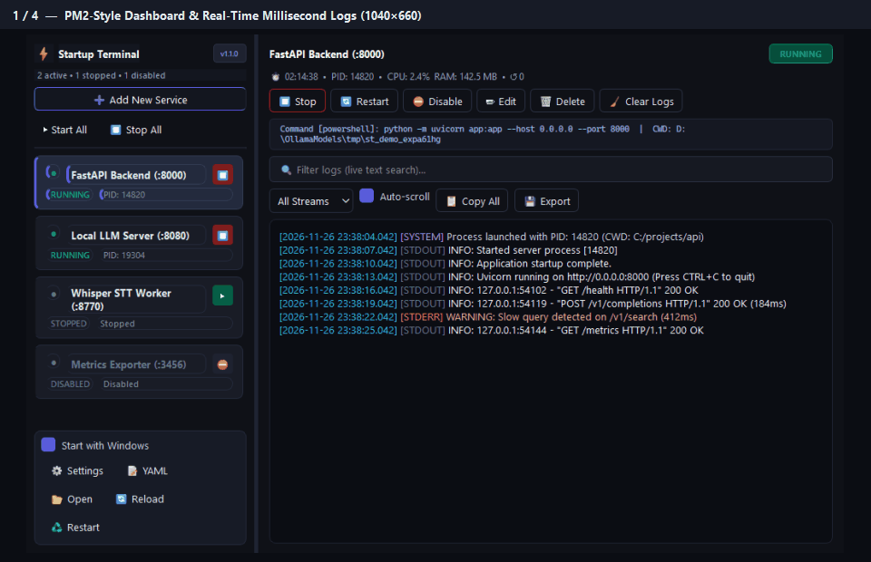

# ⚡ Startup Terminal

**PM2-style desktop server & background job manager for Windows** — starts silently with Windows, keeps services alive across app restarts & updates, prevents duplicate port conflicts, and streams color-coded logs with millisecond timestamps.

<p align="center">
  
</p>

---

## ✨ What It Does

| Feature | Details |
|---|---|
| **🚀 PM2-Style Controls** | Start, Stop, Restart, Enable/Disable services individually or all at once (`▶ Start All` / `⏹ Stop All`). Right-click any card to edit or manage. |
| **🛡 Survives Reboots & App Restarts** | Registers in Windows Startup (`HKCU\...\Run`) with zero console window. Clicking **♻ Restart** or auto-updating detaches running services and re-attaches cleanly via `%LOCALAPPDATA%\StartupTerminal\state.json`. |
| **🔒 Double-Run Guard & Crash Recovery** | Detects if a service's port is already listening on `127.0.0.1` to prevent collisions, and optionally auto-restarts crashed services after a configurable delay. |
| **⏱ Real-Time Millisecond Logs** | Color-coded `[STDOUT]` / `[STDERR]` / `[SYSTEM]` streams with millisecond timestamps, live search, stream filters, auto-scroll lock, persistent rotating log files (10 MB), copy, and export. |
| **📱 Responsive Scaling & Wrapping UI** | `FlowLayout` + `WrapButton` keep every action button readable even in compact `620×440` windows. Remembers window geometry, splitter position, and custom **UI Scale** (`75%–200%`). |
| **⚙ Settings & GitHub Auto-Updater** | Tabbed **⚙ Settings** dialog (`General`, `Services & Logs`, `Updates`) with automatic SHA256-verified GitHub Releases updates for both standalone `.exe` and `uv tool` installs. |

---

## 🚀 Quick Install

### Windows — Standalone GUI Executable (Recommended, no Python required)

```powershell
$dir = "$env:LOCALAPPDATA\StartupTerminal"
New-Item -ItemType Directory -Force -Path $dir | Out-Null
Invoke-WebRequest "https://github.com/hakanu/startup-terminal/releases/latest/download/startup-terminal-windows-x64.exe" -OutFile "$dir\startup-terminal.exe"
& "$dir\startup-terminal.exe" --install-shortcut
& "$dir\startup-terminal.exe" --autostart
Start-Process "$dir\startup-terminal.exe"
```

### Linux (x64) — Standalone Binary (no Python required)

```bash
mkdir -p ~/.local/bin
curl -fsSL "https://github.com/hakanu/startup-terminal/releases/latest/download/startup-terminal-linux-x64" -o ~/.local/bin/startup-terminal
chmod +x ~/.local/bin/startup-terminal
~/.local/bin/startup-terminal --install-shortcut
~/.local/bin/startup-terminal --autostart
~/.local/bin/startup-terminal &
```

### Python / `uv tool` (Windows & Linux)

```bash
uv tool install git+https://github.com/hakanu/startup-terminal.git
```

Or run directly from source:

```powershell
pip install -r requirements.txt
py main.py
```

---

## ⌨️ CLI Commands

| Command | Description |
|---|---|
| `startup-terminal` | Launch the GUI dashboard |
| `startup-terminal --minimized` | Start minimized in the Windows system tray |
| `startup-terminal --config <path>` | Load a custom `config.yaml` |
| `startup-terminal --install-shortcut [--desktop]` | Create Start Menu (and optional Desktop) shortcut |
| `startup-terminal --autostart` / `--no-autostart` | Enable or disable silent Windows login startup |
| `startup-terminal --update` | Self-update from GitHub Releases / `uv` |
| `startup-terminal --version` | Print installed version |

---

## 📁 Configuration (`config.yaml`)

Services can be added and edited directly in the GUI (**➕ Add New Service** or **📝 YAML**). Configuration is stored in `./config.yaml` (workspace) or `%APPDATA%\StartupTerminal\config.yaml`:

```yaml
services:
  - id: "fastapi-backend"
    name: "FastAPI Backend"
    command: "python -m uvicorn app:app --port 8000"
    shell: "cmd"          # cmd | powershell | pwsh (supports multi-line YAML '|' scripts)
    cwd: "C:/projects/api"
    enabled: true
    auto_start: true
    restart_on_failure: true
    restart_delay_sec: 3
    env:
      PORT: "8000"
```

---

## 🔄 Auto-Updates

- **Standalone Windows `.exe`**: Checks GitHub Releases asynchronously, verifies `SHA256SUMS.txt`, detaches running services so they stay online, swaps the binary atomically, and relaunches cleanly.
- **`uv tool` / `pip`**: Automatically upgrades from the latest GitHub Release `.whl` asset (with corrupted-venv recovery).
- Configure auto-check / auto-install anytime in **⚙ Settings → Updates**.
